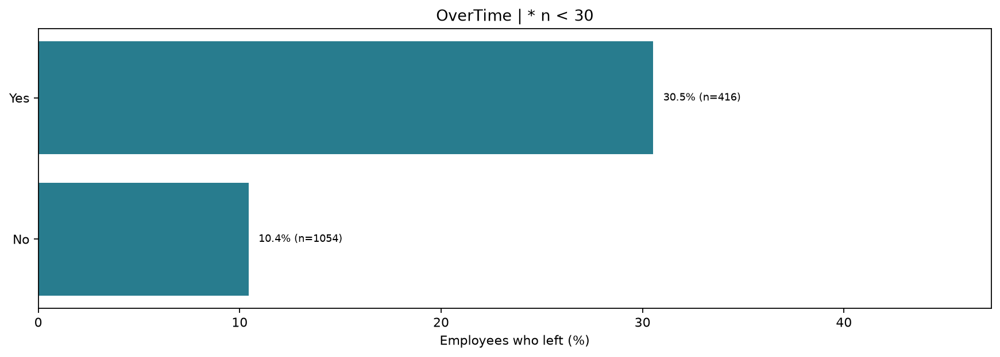
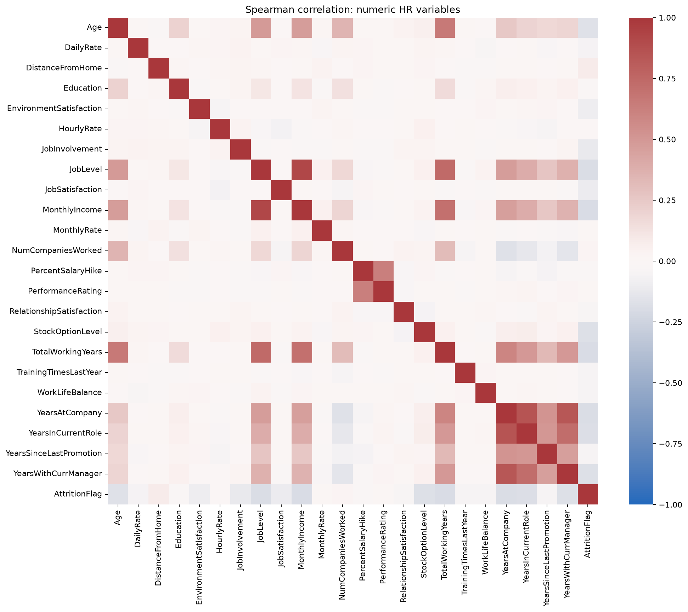

# Understanding Employee Attrition

Programming for Scientific Computing | B.Tech CSE-G | Faculty: Vatsal Shingala

An exploratory Python study of the fictional IBM HR sample: data validation, group attrition rates, the proposal's 12 figures, statistical tests and an optional logistic regression baseline.

| Member | Enrollment | Assigned responsibility |
|---|---|---|
| Milan Nakum | IU2441230688 | Preparation, categorical plots, setup and results |
| Rudra Patel | IU2441230682 | Dictionary, numeric plots, statistics and optional model |

The table lists each member's assigned responsibilities.

## Run on Windows

Use Python 3.14 (the version tested in CI). From the repository folder:

```powershell
python -m venv .venv
.venv\Scripts\python.exe -m pip install -r requirements.txt
.venv\Scripts\python.exe run_analysis.py --model
.venv\Scripts\python.exe -m pytest -q
```

Omit `--model` to run only the required exploratory analysis. After installation and obtaining the CSV, the analysis runs offline without any API key.

To run Milan's portion independently:

```powershell
.venv\Scripts\python.exe run_milan.py
.venv\Scripts\python.exe -m pytest tests/test_milan.py -q
```

This exports the cleaned data, audit, nine group tables, seven categorical figures and [Milan's computed results](reports/milan_results.md). It does not execute the numeric plots, statistical tests or optional model. Follow [Milan's walkthrough](docs/milan_walkthrough.md) for explanations and the commit file list.

For notebooks, select the environment interpreter in your editor, or run `.venv\Scripts\python.exe -m notebook`. Run the numbered notebooks in order from fresh kernels. The notebooks find the repository from its root or the notebooks folder.

## Run on macOS / Linux

Use Python 3.14 (the version tested in CI). From the repository folder:

```bash
python3 -m venv .venv
source .venv/bin/activate
python -m pip install -r requirements.txt
python run_analysis.py --model
python -m pytest -q
```

To run Milan's portion independently:

```bash
python run_milan.py
python -m pytest tests/test_milan.py -q
```

For notebooks, run `python -m notebook` with the environment activated.

## Key findings

| Finding | Attrition rate |
|---|---|
| Overtime vs no overtime | 30.53% vs 10.44% |
| Sales Representative | 39.76% |
| Age 18–29 | 27.91% |
| Job level 1 | 26.34% |





These are descriptive group rates from a single snapshot and do not establish causes.

## Structure and outputs

```text
data/raw/              Unchanged source CSV
data/processed/        Generated cleaned CSV
docs/                  Proposal, dictionary, source and team guide
notebooks/             01 cleaning; 02a categorical; 02b numeric; 03 tests; 04 model
src/                   Data preparation; categorical.py (Milan); numeric plots, statistics and model
tests/                 Input, denominator and adjustment checks
visualizations/        Twelve generated PNG figures
reports/               Audit, tables, statistics, model metrics and results
run_analysis.py        Reproduce the analysis
run_milan.py           Run Milan's portion independently
requirements.txt       Direct dependencies
requirements-lock.txt  Exact verified Python environment
LICENSE                MIT license
```

Read [computed results](reports/results.md), [team workflow](docs/team_workflow.md) and [faculty demo](docs/faculty_demo.md).

## Methods

Validate missing values, CSV structure, known source categories, numeric fields, ratings and conflicting IDs. Remove exact duplicates, the three fixed metadata constants (EmployeeCount, StandardHours, Over18) and the employee identifier. Retain other constant predictors so feature selection is not learned from the full dataset before splitting. Define age/rating labels and a binary attrition flag. Keep outliers visible. Report pay-rate correlations and retain these fields: weak income correlation alone is insufficient grounds for removal.

Categorical plots show within-group percentages and denominators; groups below 30 are flagged. The statistical table contains 16 comparisons: eight chi-square tests with Cramer's V, four Spearman ordinal trend tests (job level, job satisfaction, environment satisfaction and work-life balance), and four Mann-Whitney U tests with signed rank-biserial effects. Flag sparse expected counts and apply one Holm adjustment across all testable comparisons, including the ordinal trends. A missing class, constant category or zero rank variance is marked `not_testable`, with an explanation and no invented p-value. Ordinal trends require at least three observations. These tests are exploratory; the 12 proposal figures are a separate count.

Optional model: fixed stratified 80/20 split, training-only preprocessing, balanced logistic regression and majority baseline; report precision, recall, F1, ROC-AUC and confusion counts.

## Deviations from the proposal

The proposal planned to exclude DailyRate, HourlyRate and MonthlyRate if they were unrelated to income. Their Spearman correlations with income are 0.016, -0.020 and 0.054. We kept them because a weak correlation alone is not enough reason to drop a field.

## Input contract and verification

Inputs must follow the IBM HR source schema. Unexpected/duplicate columns, malformed CSV records, unsupported categorical codes, missing values, negative/nonfinite numeric values and numeric values above the implementation bound of 1e12 are rejected explicitly. Counts, ages, IDs and ordinal codes must be whole numbers. The bound is a numerical safety limit, not a claim about realistic HR values. Supply original CSV data rather than a previously processed CSV with derived fields.

Single-class or tiny datasets can still produce descriptive results; a requested model must have both classes in training and holdout. Specify `--output-dir` to keep experiments on different datasets separate. Outputs are generated in a temporary folder before publication; completed results include input checksums. A full run without `--model` removes its stale model-metrics file.

Run `python -m pytest -q` and `python scripts/verify_notebooks.py` using the project environment. See [the testing report](docs/testing_report.md) for coverage, reproduced defects, results and remaining limits.

## Data and limitations

Source: [Kaggle, pavansubhasht](https://www.kaggle.com/datasets/pavansubhasht/ibm-hr-analytics-attrition-dataset). See [provenance and dataset license](docs/data_source.md). The standard sample has 1,470 rows and 35 fields; the audit records actual dimensions and SHA-256.

The dataset is fictional and does not describe actual IBM employees. A single snapshot, class imbalance, small groups and exploratory comparisons limit interpretation. Associations do not establish causes. A single model holdout is an educational comparison, not deployment validation.

## Contribution evidence

Use the commit history, completed reviews and team log to document contributions. Each member should be able to explain the methods and results in their assigned portion. Commit counts alone do not measure effort.

## License

Released under the MIT License. See [LICENSE](LICENSE).
